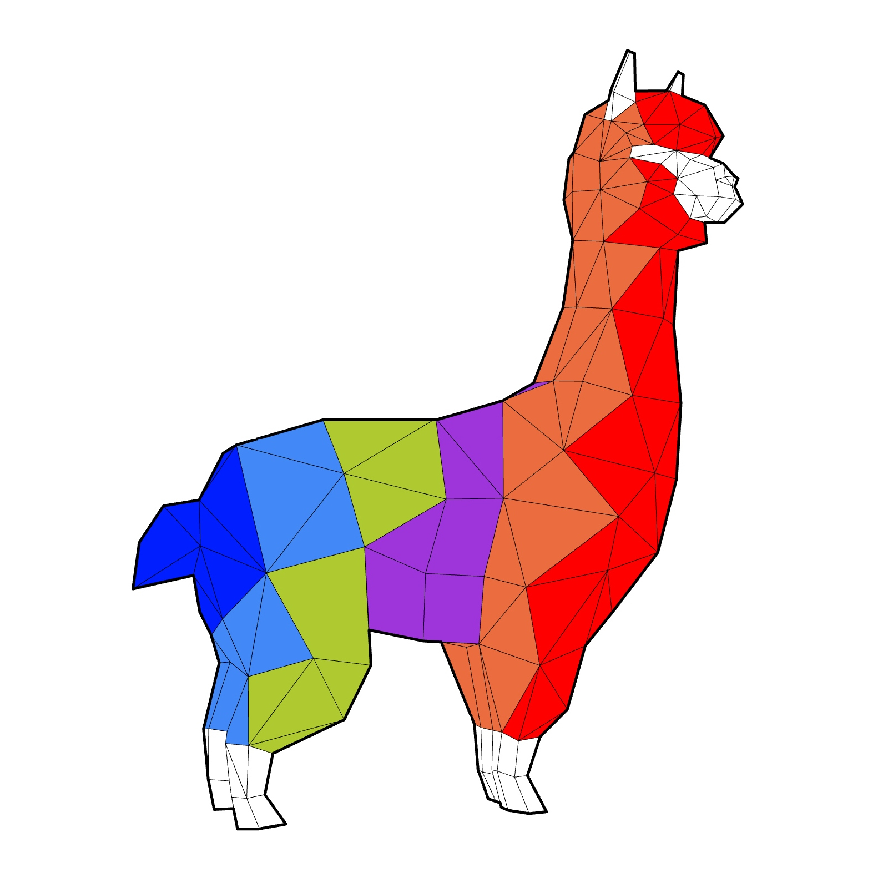
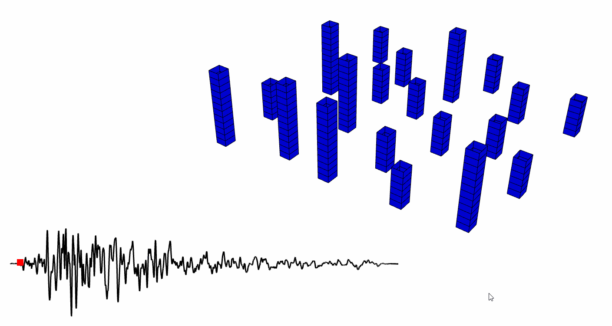

# Alpaca4d

**OpenSees for Grasshopper. Structural analysis at the speed of design.**

Alpaca4d connects Rhino and Grasshopper to [OpenSees](https://opensees.berkeley.edu/), the finite
element engine from UC Berkeley (subject to [its own license](https://opensees.berkeley.edu/OpenSees/copyright.php)).
Model beams, shells and solids, run static, modal, buckling and earthquake analyses, and explore
hundreds of design options, without writing a line of code.

  

## Install

Alpaca4d runs on Rhino 7 and Rhino 8, on Windows and macOS.

1. In Rhino, open the Package Manager from the Tools menu.
2. Search for **Alpaca4d** and click Install, then restart Rhino.
3. Download OpenSees yourself and tell Alpaca4d where it is, once:
   [setup guide](https://alpaca4d.github.io/docs/setup.html).

Step by step: [Download](https://alpaca4d.github.io/download.html).

## Learn

- [Docs](https://alpaca4d.github.io/docs/): every component, and lessons from a first beam to a whole structure.
- [Examples](https://alpaca4d.github.io/examples/): Grasshopper definitions to open and take apart.

## Free, or licensed

Without a license you can build and analyse models of up to 50 elements, and run Topology
Optimisation on models of up to 500. A license lifts the limits and unlocks the section tools,
Explorer and the other optimisers. See [plans and prices](https://alpaca4d.github.io/buy.html).

## Questions, bugs and ideas

[Open an issue](https://github.com/Alpaca4d/Alpaca4d/issues/new) here. Attach the Grasshopper file
if you can, and say which Rhino and Alpaca4d versions you use.

The source code of Alpaca4d is kept in a private repository. This one is its public home: the
place to report issues and follow the project.

## Credits

Alpaca4d uses the **MPCO recorder**, written by M. Petracca and G. Camata of
[ASDEA Software Technology](https://asdeasoft.net/?home), Pescara, Italy.

## Disclaimer

The authors cannot be held responsible for the results. Always check them with another finite
element package before using them for design or documentation.

## Contact

[alpaca4d@gmail.com](mailto:alpaca4d@gmail.com) ·
[LinkedIn](https://www.linkedin.com/company/alpaca4d/) ·
[Instagram](https://www.instagram.com/alpaca4d/)
